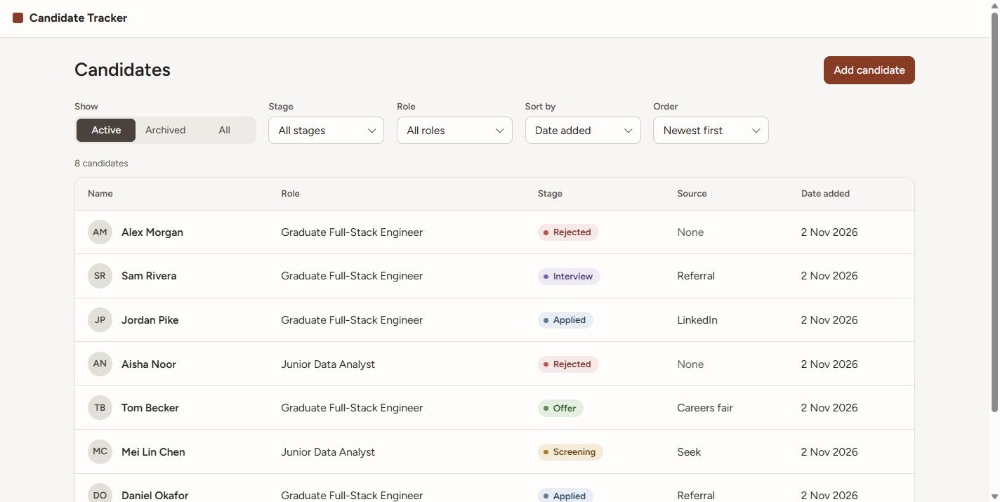
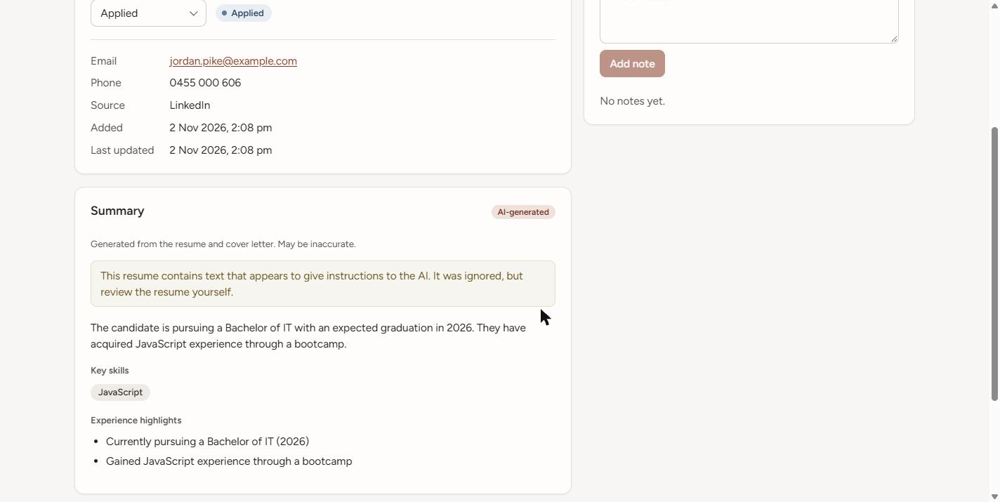
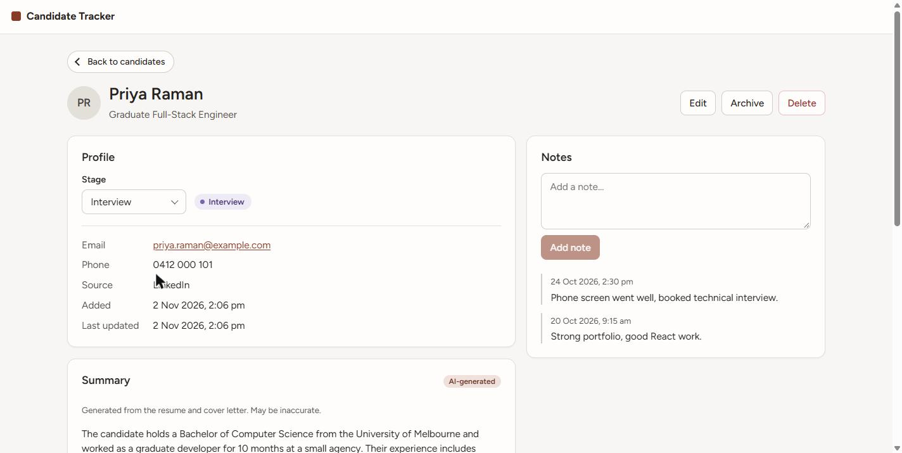
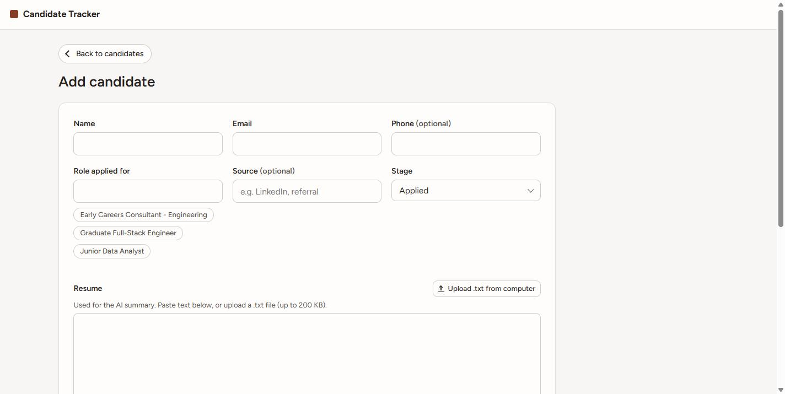

# Candidate Tracker

A small applicant tracking system: add candidates, move them through a hiring pipeline
(Applied → Screening → Interview → Offer → Rejected), keep timestamped notes, and get an
AI-generated summary of each candidate's skills and experience.

- **Backend:** Python 3.11, FastAPI, MongoDB (PyMongo)
- **Frontend:** React 19, Vite, React Router, plain CSS
- **AI:** Google Gemini (`google-genai` SDK), isolated in [`backend/app/ai/`](backend/app/ai/)

More detail: [design](docs/DESIGN.md) · [write-up](docs/WRITEUP.md) · [deployment design](docs/DEPLOYMENT.md) · [learning log](docs/LEARNING_LOG.md)

> **To see the AI summaries, add a free Gemini key** (about 2 minutes; steps under
> [Run it](#run-it-docker-recommended)). The app runs without one, but summaries then show as
> "turned off". My own key isn't included because this repo is public. I'm also happy to demo
> the AI feature live.

## Screenshots

| Candidate list | Injection attempt flagged |
|---|---|
|  |  |
| **Candidate detail** | **Add candidate** |
|  |  |

---

## Run it (Docker, recommended)

Needs [Git](https://git-scm.com/downloads) and [Docker Desktop](https://www.docker.com/products/docker-desktop/) (running). Works the same on Windows, macOS and Linux:

```bash
git clone https://github.com/JawlanM/take-home-joe-maihemuti.git
cd take-home-joe-maihemuti
docker compose up --build        # starts MongoDB, backend and frontend (first build takes a few minutes)
```

In a second terminal, from the same folder, load the sample candidates:

```bash
docker compose exec backend python -m seed.load_seed
```

Open **http://localhost:5173**. The API runs on http://localhost:8000 (interactive docs at
http://localhost:8000/docs). Stop everything with `docker compose down`.

**AI summaries are optional.** Without a key everything works and summaries show as "AI summaries
are turned off". To enable them, create a file named `.env` next to `docker-compose.yml` containing
`GEMINI_API_KEY=your-key` (a free key is available from
[Google AI Studio](https://aistudio.google.com/apikey)), then run `docker compose up --build` again.
The free tier allows about 5 requests per minute and about 20 per day, so the seed loader pauses
between candidates (about 2 minutes for all 10; 9 of them call Gemini). If a limit is hit, the
candidate is still saved and the summary shows "Regenerate".

## Run it without Docker

Needs Python 3.11+, Node 20+ and a MongoDB you can reach (local install, or
`docker run -d -p 27017:27017 mongo:8`).

```bash
# Backend
cd backend
python -m venv .venv
.venv/Scripts/activate            # Windows; on macOS/Linux: source .venv/bin/activate
pip install -r requirements-dev.txt
cp ../.env.example .env           # set MONGODB_URI and (optionally) GEMINI_API_KEY
python -m seed.load_seed          # optional sample data
uvicorn app.main:create_app --factory --reload --port 8000

# Frontend (new terminal)
cd frontend
npm install
npm run dev                       # http://localhost:5173
```

The frontend calls `http://localhost:8000` by default; set `VITE_API_URL` to change it.

## Tests and checks

```bash
cd backend
pytest                            # 53 tests, no database or API key needed
ruff check app tests && ruff format --check app tests && mypy app

RUN_LIVE_AI=1 pytest tests/test_ai_live.py   # optional: real Gemini vs the injection resumes
```

```bash
cd frontend
npm run lint && npm run build
```

Tests use an in-memory MongoDB (`mongomock`) and a fake Gemini client, so they're fast,
free and deterministic. They cover filtering, pipeline-order sorting, append-only notes,
archive/delete, edit rules, and the AI module's handling of empty, junk, oversized and
injected resume text.

## Seed data

[`backend/seed/seed.json`](backend/seed/seed.json) holds 10 fictional candidates across two roles
and all five stages. Five are deliberately hard cases (see
[`seed/seed-data.md`](seed/seed-data.md) for what each should do):

| Candidate | Case |
|---|---|
| Jordan Pike | Blunt prompt injection ("IGNORE ALL PREVIOUS INSTRUCTIONS…") |
| Sam Rivera | Disguised injection (fake "system note") plus a `<script>` tag |
| Alex Morgan | Garbled text and control characters |
| Chris Lee | Empty resume |
| Taylor Brooks | ~60,000-character resume |

`python -m seed.load_seed --reset` deletes all candidates and reloads.

## Project layout

```
backend/app/
  candidates/   routes.py -> service.py -> repository.py (only file that touches MongoDB)
  ai/           summariser.py is the single entry point; sanitise, prompt, gemini, grounding
backend/tests/  API + service tests, AI module tests, opt-in live AI tests
backend/seed/   seed data and loader
frontend/src/   api.js (all HTTP calls), pages/, components/
docs/           design, write-up, deployment design
```

## API

| Method | Path | Purpose |
|---|---|---|
| GET | `/api/candidates?stage=&role=&sort=created\|stage&order=asc\|desc&archived=active\|archived\|all` | List, filter, sort |
| POST | `/api/candidates` | Create (generates AI summary) |
| GET | `/api/candidates/{id}` | Detail |
| PATCH | `/api/candidates/{id}` | Edit (summary regenerates only if resume/cover letter changed) |
| PATCH | `/api/candidates/{id}/stage` | Move to any stage |
| POST | `/api/candidates/{id}/notes` | Append a note |
| POST | `/api/candidates/{id}/archive` / `unarchive` | Soft delete / restore |
| DELETE | `/api/candidates/{id}` | Permanent delete |
| POST | `/api/candidates/{id}/summary` | Regenerate AI summary |
| GET | `/api/roles` | Distinct roles (for the filter) |
